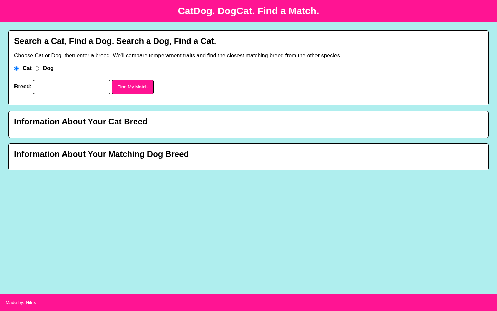
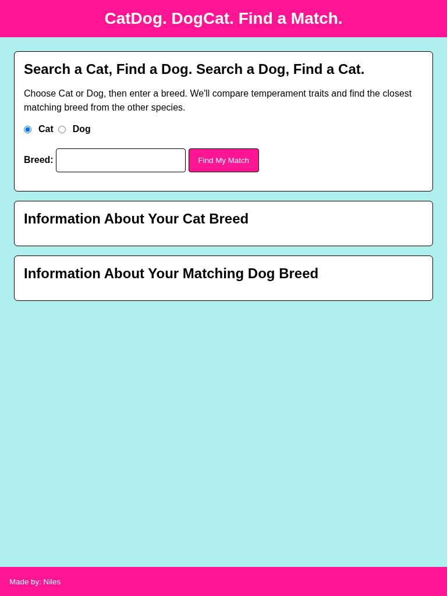
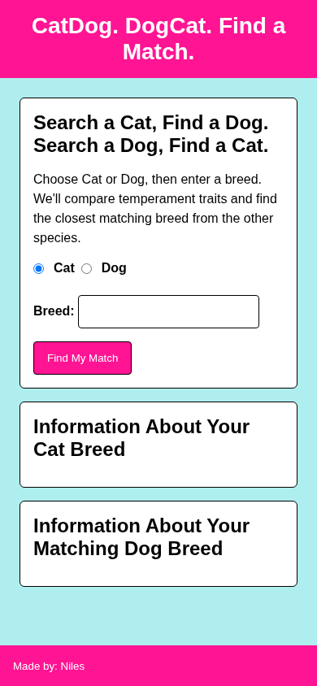

# Cat and Dog Breed Matcher

Compare a cat or dog breed with breeds of the other species using shared temperament traits.

## Overview

Cat and Dog Breed Matcher lets a user search for either a cat breed or a dog breed.

The application retrieves information about the selected breed, loads breeds from the other species, compares their temperament traits, and returns the breed with the highest number of matching traits.

## Features

- Search for a cat or dog breed
- Retrieve information about the selected breed
- Compare temperament traits across species
- Calculate a match score for each candidate breed
- Display the highest-scoring match
- Show the temperament traits shared by the matched breeds
- Display available breed details and images

## Technologies

<p>
  <a href="https://developer.mozilla.org/en-US/docs/Web/HTML" title="HTML">
    
  </a>
  &nbsp;
  <a href="https://developer.mozilla.org/en-US/docs/Web/CSS" title="CSS">
    
  </a>
  &nbsp;
  <a href="https://developer.mozilla.org/en-US/docs/Web/JavaScript" title="JavaScript">
    
  </a>
</p>

- [The Cat API](https://thecatapi.com/)
- [The Dog API](https://thedogapi.com/)

## How to Run

1. Clone the repository:

```bash
git clone https://github.com/nilesleesmith/simply-find-matching-cat-and-dog-breeds.git
```

2. Open `js/main.js`.

3. Replace the placeholder values for `theCatAPI_Key` and `theDogAPI_Key` with valid API keys.

4. Open `index.html` in a web browser.

No additional packages or build steps are required.

## Live Site

Coming soon.

## Screenshots

### Desktop



### Tablet



### Mobile


